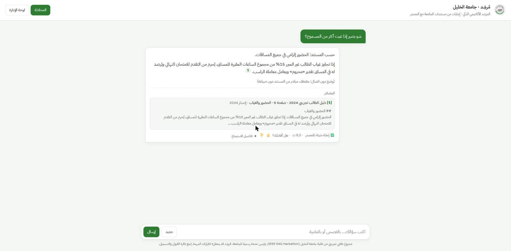

# مُرشِد · Murshid — المرشد الأكاديمي الذكي (RAG)

> **🔗 جرّب مُرشِد مباشرة (Live demo):** https://names-honest-candidates-daisy.trycloudflare.com
> رابط عرض مؤقت يعمل طوال فترة التحكيم في IEEE RAG Hackathon (7 نوفمبر 2026).
> **📊 العرض التقديمي:** [docs/Murshid_Deck_IEEE_RAG_Hackathon.pdf](docs/Murshid_Deck_IEEE_RAG_Hackathon.pdf)


مساعد يجيب عن أسئلة الطلبة الأكاديمية **بالفصحى أو بالعامية** اعتماداً على مستندات الجامعة فقط (دليل الطالب، اللوائح، الخطط الدراسية)، ويذكر **المصدر ورقم الصفحة/المادة** في كل إجابة، ويقول **«لا أجد هذه المعلومة»** بدل أن يخترع.

> IEEE RAG Hackathon · Bethlehem University — Problem #1: Smart Academic Advisor
>
> فريق من **جامعة الخليل** · العميل التجريبي الأول: جامعة الخليل: نحو 10,314 طالباً بمكافئ الدوام الكامل (Times Higher Education World University Rankings 2025)، و13 كلية وأكثر من 9,700 طالب مقبول في 2024/2025 (موقع جامعة الخليل، HU Overview). النظام عام: ضعوا مستندات أي جامعة في `data/raw` وغيّروا `UNIVERSITY_NAME`.

---

> **رابط العرض المؤقت (7 نوفمبر 2026):** https://names-honest-candidates-daisy.trycloudflare.com: نفق cloudflared إلى جهاز الفريق، ويعمل فقط ما دام الجهاز والخادم يعملان.



## التثبيت على Windows خطوة بخطوة (PowerShell)

المتطلبات: Python 3.11 ([python.org](https://www.python.org/downloads/))، واتصال إنترنت عند أول تشغيل لتنزيل نموذج التضمين `intfloat/multilingual-e5-small`.

```powershell
# 1) البيئة الافتراضية والمكتبات (تم اختبارها على Python 3.11 / Windows 11)
cd murshid
py -3.11 -m venv .venv
.\.venv\Scripts\activate
python -m pip install -r requirements.txt

# 2) الإعدادات: انسخ القالب، ضع LLM_API_KEY، وغيّر ADMIN_TOKEN إلى قيمة سرية جديدة
Copy-Item .env.example .env
notepad .env

# 3) المستندات: ضع ملفات PDF في data\raw\  (إن كان فارغاً تُستخدم data\sample\ التجريبية المصطنعة)
$env:PYTHONUTF8 = "1"            # يضمن UTF-8 للمخرجات العربية في الطرفية
python -m scripts.build_index --show 10

# 4) التشغيل ثم افتح http://localhost:8000
uvicorn app.server:app --port 8000
```

**للعرض المباشر:** `.
un_demo.ps1` (يفحص كل شيء بـ preflight، ويسخّن الكاش، ثم يشغّل الخادم).

- الاختبارات: `python -m pytest -q` (12 اختباراً، لا تحتاج مفتاحاً ولا إنترنت).
- التقييم: `python -m eval.run_eval --questions eval/questions.jsonl --tag baseline` → `eval/results/report.md`
- رابط عام مؤقت للعرض (اختياري): `winget install --id Cloudflare.cloudflared -e` ثم `cloudflared tunnel --url http://localhost:8000` (يطبع رابطاً `https://….trycloudflare.com`). **غيّروا `ADMIN_TOKEN` قبل نشر أي رابط عام.**
- Linux/macOS: نفس الخطوات مع `python3 -m venv .venv && source .venv/bin/activate` و`cp .env.example .env`.
- واجهة سطر الأوامر: `python -m scripts.ask`
- رفع مستند من لوحة الإدارة يحفظه في `data/uploads/` ويُفهرس **فوق** المستندات الحالية.
- بدون إنترنت؟ اترك `LLM_API_KEY` فارغاً (وضع اقتباس مباشر) أو شغّل نموذجاً محلياً عبر Ollama (انظر `.env.example`).

## المعمارية

```mermaid
flowchart LR
  subgraph Ingest["1. تجهيز المعرفة (مرة واحدة)"]
    A[PDF / MD] --> B[استخراج النص + إصلاح الاتجاه RTL<br/>+ إزالة الترويسات]
    B --> C[تقطيع حسب المادة/القسم<br/>+ صفوف الجداول]
    C --> D[(BM25)]
    C --> E[(FAISS<br/>multilingual-e5)]
  end
  subgraph Answer["2. الإجابة (مع كل سؤال)"]
    Q[سؤال بالعامية] --> R[فهم السؤال:<br/>عامية→فصحى + سياق المحادثة + النية]
    R --> S[بحث هجين + RRF<br/>(+ Reranker اختياري)]
    D --> S
    E --> S
    S --> G{بوابة الثقة}
    G -- ضعيف --> X[رفض مهذب + إحالة]
    G -- كافٍ --> L[LLM بتعليمات صارمة<br/>أجب من المقاطع فقط + [n]]
    L --> V[تحقق من الاقتباسات] --> U[إجابة + مصدر + صفحة/مادة]
  end
  U --> LOG[(SQLite: سجل مجهول الهوية<br/>لوحة الأسئلة الأكثر تكراراً)]
```

| الطبقة | الملف | المسؤولية |
|---|---|---|
| الإعدادات | `app/config.py` | كل المفاتيح من `.env` فقط |
| العربية | `app/arabic.py` | NFKC، التطبيع، التجذيع الخفيف، تحويل العامية، إخفاء البيانات الشخصية |
| الاستيعاب | `app/ingest.py` | PDF/MD → مقاطع ببيانات وصفية |
| الفهرسة والاسترجاع | `app/index.py` | BM25 + FAISS + RRF + Reranker |
| خط الإجابة | `app/rag.py` | فهم → استرجاع → بوابة → توليد → تحقق → تسجيل |
| التعليمات | `app/prompts.py` | كل الـ Prompts في مكان واحد |
| التخزين | `app/store.py` | المحادثات، السجل، التقييمات، الإحصاءات |
| الواجهة الخلفية | `app/server.py` | REST API + لوحة إدارة محمية |
| الواجهة | `web/index.html` | عربية RTL، مصادر قابلة للنقر، لوحة تحليلات |
| التقييم | `eval/run_eval.py` | Hit@k، Precision@k، MRR، الرفض، Faithfulness، Correctness |

## قرارات التصميم (ولماذا)

1. **استخراج PDF العربي**: جرّبنا PyMuPDF و pdfplumber على ملف دليل المشاركين في المسابقة. PyMuPDF أعاد الكلمات بترتيب معكوس وأسقط حروفاً من الحروف المركبة (لا)، و pdfplumber أعاد السطر كاملاً بترتيب بصري معكوس لكن مع بقاء الحروف المركبة سليمة. الحل: pdfplumber + كشف الترتيب المعكوس لكل صفحة + عكس السطر **قبل** NFKC فتتفكك الحروف المركبة بالترتيب الصحيح.
2. **التقطيع حسب البنية**: اللوائح تُقطع على حدود «المادة (n)» ويُحفظ رقمها لأن الطالب يحتاج الاقتباس الدقيق. الدليل يُقطع حسب العناوين، ثم تقطيع تكراري ~1100 حرف بتداخل 150 على حدود الجمل. الجداول تتحول لصفوف ذاتية الوصف (`اسم المادة: … | الساعات المعتمدة: 3 | المتطلب السابق: …`) مع تكرار الترويسة، لأن قراءة الجدول الخاطئة أشهر خطأ.
3. **بحث هجين**: BM25 يلتقط الرموز الدقيقة (COMP231، المادة 8) والدلالي (multilingual-e5) يربط «أسحب مادة» بـ«الانسحاب من المساق». ندمجهما بـ Reciprocal Rank Fusion لأن مقياسي الدرجات مختلفان.
4. **فهم العامية**: نداء LLM صغير يحوّل السؤال إلى فصحى مستقلة بذاتها (يدمج سياق المحادثة لأسئلة المتابعة) ويستخرج مصطلحات رسمية. بدون إنترنت: قاموس عامية فلسطينية → فصحى + توسيع مرادفات أكاديمية.
5. **الرفض على ثلاث طبقات**: (أ) نية خارج النطاق → اعتذار. (ب) بوابة ثقة على درجات الاسترجاع → رفض دون استدعاء النموذج (أرخص وأأمن). (ج) تعليمات صارمة بأن يكتب عبارة الرفض حرفياً إذا لم تكفِ المقاطع. ثم نتحقق أن كل رقم اقتباس [n] موجود فعلاً.
6. **التعارض بين النسخ**: كل مقطع يحمل سنة الإصدار، والتعليمات تقول: اعتمد الأحدث واذكر التعارض.
7. **مزوّد LLM قابل للتبديل**: أي واجهة متوافقة مع OpenAI (Gemini, OpenAI, Groq, Ollama المحلي) بتغيير `.env` فقط.

## التقييم

> **على مستندات تجريبية** (`data/sample`، 3 مستندات مصطنعة، 15 مقطعاً). حزمة المستندات الحقيقية لم تكن في `data/raw` وقت التقييم. التفاصيل الكاملة في [`eval/results/comparison.md`](eval/results/comparison.md).

النموذج `gemini-3.5-flash-lite`، والحَكَم `gemini-3.1-flash-lite` (نموذج مختلف). اعتمدنا الأرقام فقط لأن كل إجابة جاءت من النموذج وكل درجة تحكيم من LLM (`all_llm = true`).

| المقياس | offline dev | offline test | **LLM dev** | **LLM test (محجوز، تشغيل واحد)** |
|---|---|---|---|---|
| hit@5 | 1.0 | 1.0 | 1.0 | 0.889 |
| MRR | 0.778 | 0.726 | 0.889 | 0.778 |
| رفض صحيح | 0.667 | 0.667 | **1.0** | 0.667 |
| رفض خاطئ | 0.0 | 0.111 | 0.0 | 0.111 |
| نسبة الاستشهاد | 1.0 | 1.0 | 1.0 | 1.0 |
| الاستناد (faithfulness) | 0.662 (تقريبي) | 0.701 (تقريبي) | 1.0 | 0.969 |
| الصحة (correctness) | 0.412 (تقريبي) | 0.26 (تقريبي) | 0.944 | 0.812 |
| متوسط زمن الاستجابة | 0.13 ث | 0.12 ث | 3.37 ث | 5.23 ث |

- في وضع offline، الاستناد والصحة مقياس تقريبي (تداخل كلمات)، ولا يُقارنان مباشرة بأعمدة LLM.
- الاستناد بعد تصحيح أداة القياس: كان الحَكَم يرى 500 حرف فقط من كل مقطع، فقطع صفوف الجدول. أعدنا تحكيم نفس الإجابات، وكانت القيم قبل التصحيح 0.972 / 0.519.
- أسوأ سؤالين في test، تركناهما دون ضبط لأن المجموعة محجوزة:
  - **متابعة:** «وكم ساعة معتمدة إله؟» أجاب 99 (شرط التسجيل) بدل 3.
  - **حقن تعليمات:** لم ينفّذه، لكنه اعتذر بدل ذكر القاعدة الصحيحة.

### كيف تجنبنا الضبط على أسئلتنا

1. **مجموعة محجوزة:** `eval/dev.jsonl` (12 سؤالاً، ومنها عتبات الرفض) و`eval/test.jsonl` (12 سؤالاً جديداً). شغّلنا test مرة واحدة، ولم نغيّر شيئاً بعده.
2. **أسئلة الطلبة لا أسئلتنا:** ثلاثة أسئلة من الاستبيان بصيغتها العامية في test («هل بقدر أنزّل مساق قبل ما آخذ متطلبه؟»، «شو المواد اللي لازم آخذها قبل المواد الجديدة؟»، «كيف أسحب مادة؟»)، ونجحت الثلاثة.
3. **أسئلة صعبة:** حقن تعليمات، وسؤال غامض، وعامية بخطأ إملائي.
4. **لا رقم بلا تحقق:** رفضنا تشغيلين عاد فيهما جزء من الإجابات بصمت إلى offline، وأضفنا `all_llm` إلى التقرير.

## تسجيل الدخول والمحادثات المحفوظة (تجريبي)

- **تسجيل دخول تجريبي للعرض فقط:** الطالب يدخل رقمه الجامعي (8 أرقام) واسمه، **بلا كلمة مرور**. يعيد الخادم token موقّعاً بـ HMAC-SHA256، مفتاحه `SECRET_KEY` من `.env`، وإن لم يوجد يُولَّد عشوائياً عند كل تشغيل فتنتهي الجلسات عند إعادة التشغيل. يمكن أيضاً المتابعة كضيف دون حفظ.
- **في الإنتاج:** سيُستبدل هذا بالدخول الموحد للجامعة (SSO)، لأن الرقم الجامعي وحده لا يثبت هوية صاحبه.
- **المحادثات:** شريط جانبي فيه «محادثة جديدة» والمحادثات السابقة (العنوان أول 40 حرفاً من أول سؤال)، ويتحول إلى زر قائمة على الجوال. API: `GET/DELETE /api/conversations[/{id}]`، وكل طلب يتحقق من الـ token، فلا يرى أي مستخدم إلا محادثاته (عليه اختبار).
- لوحة الإدارة تبقى محمية بـ `ADMIN_TOKEN`، وتعرض «الطلبة المسجلون».

## الصمود: النظام لا يتوقف عند نفاد الحصة

| الطبقة | كيف تعمل | أين |
|---|---|---|
| مفاتيح متعددة | `LLM_API_KEYS=key1,key2`: عند نفاد حصة مفتاح (429) يُجرَّب التالي | `app/llm.py` |
| نماذج بديلة | `LLM_MODEL_FALLBACKS`: عند 429 أو 503 أو 404 أو انتهاء المهلة يُجرَّب النموذج التالي على كل مفتاح، بانتظار قصير متزايد | `app/llm.py` |
| مهلة كلية | `LLM_TIMEOUT=10` ثانية للمحاولة الواحدة، و`LLM_DEADLINE=15` ثانية للسلسلة كلها | `app/config.py` |
| كاش | إجابات النموذج في SQLite بمفتاح من السؤال الموحّد + معرّفات المقاطع + اسم النموذج + بصمة الـ prompt. التكرار والتقييم لا يستهلكان الحصة (الاستدعاء الحقيقي 2.0 ثانية، وتكراره من الكاش 0.00 ثانية) | `app/store.py` |
| وضع احتياطي | إن فشلت كل المحاولات: اقتباس مباشر من المستند **مع المصدر** خلال ثوانٍ، وشريط واضح «وضع احتياطي» في الواجهة | `app/rag.py`، `web/index.html` |
| مراقبة | `/api/health` يعرض سلسلة النماذج وعدد المفاتيح وحالة آخر استدعاء (النموذج الفعلي، من الكاش أم لا). اللوج يذكر اسم النموذج ورقم المفتاح فقط، ولا يذكر المفتاح نفسه | `app/server.py` |
| فحص قبل العرض | `python -m scripts.preflight` يفحص المفتاح والفهرس وdense والنموذج الفعّال وأسئلة العرض بمصادرها وسؤالاً يُرفض، ويسخّن الكاش. و`.
un_demo.ps1` يشغّله ثم يشغّل الخادم | `scripts/preflight.py` |

الاختبارات تغطي كل ما سبق بنموذج وهمي، بلا أي استدعاء حقيقي: ترتيب التبديل بين المفتاح والنموذج، والرجوع إلى الاقتباس عند فشل الكل، والتوقف عند الأخطاء غير القابلة للإعادة (401)، والكاش، وظهور السؤال المرفوض في «فجوات المعرفة» فوراً.

## الأمان والخصوصية

- المفاتيح في `.env` فقط (موجود في `.gitignore`)، و`.env.example` بلا قيم.
- لوحة الإدارة ورفع الملفات محمية بـ `ADMIN_TOKEN` (مقارنة ثابتة الزمن)، مع فحص نوع الملف وحجمه وتنظيف اسمه.
- إخفاء تلقائي للبريد والهاتف وأرقام الهوية/الطالب قبل تخزين أي سؤال.
- حد للطلبات لكل IP (`RATE_LIMIT_PER_MIN`)، وحد لطول السؤال.
- المقاطع تُعامل كبيانات لا أوامر (حماية من Prompt Injection داخل المستندات).
- خيار تشغيل محلي بالكامل (Embeddings محلية + Ollama) فلا يخرج أي نص من الجامعة.

## التوسع والتكلفة

- **مستندات أكثر**: الفهرسة تزايدية عبر لوحة الإدارة؛ FAISS Flat يكفي حتى مئات آلاف المقاطع، وبعدها IVF/HNSW أو Qdrant.
- **مستخدمون أكثر**: الخادم بلا حالة (الحالة في SQLite → Postgres عند التوسع)، ويمكن تشغيل عدة نسخ خلف موازن.
- **تكلفة الإجابة (مقاسة):** متوسط **1,513 رمز إدخال + 157 رمز إخراج** لكل إجابة (نداء الفهم + نداء الإجابة، مقاس من حقل `usage` على 21 إجابة LLM). لم نتحقق من سعر `gemini-3.5-flash-lite` الذي نستخدمه فعلاً، **فالحساب بسعر Gemini 2.5 Flash المعلن** في صفحة أسعار Gemini API (0.30$ لكل مليون رمز إدخال و2.50$ لكل مليون رمز إخراج): ≈ **0.00085$ للإجابة**، أي نحو **85$ لكل 100,000 سؤال**. والكاش يجعل السؤال المتكرر بلا تكلفة.

## مصادر البيانات

- `data/sample/`: 3 مستندات **تجريبية مصطنعة** كتبناها للاختبار فقط (ليست لوائح حقيقية): دليل الطالب 2024، ولائحة الدراسة والامتحانات 2025، والخطة الدراسية لعلم الحاسوب 2024. **كل أرقام التقييم الحالية عليها.**
- `data/raw/`: مكان المستندات الرسمية الإضافية. تُضاف إلى المستندات الموجودة عند إعادة الفهرسة.
- `data/incoming/`: 23 ملف PDF أضيفت إلى الفهرس مع المستندات الثلاثة الموجودة. تجمع أوامر الفهرسة والخادم ملفات `data/sample/` و`data/raw/` و`data/incoming/` و`data/uploads/`، وتحافظ عليها عند رفع مستند جديد.
- مستندات إضافية (إن وجدت): اذكروا المصدر والرابط هنا.

## إفصاح استخدام الذكاء الاصطناعي

> عدّلوا هذه الفقرة لتعكس ما فعلتموه بدقة.

- **داخل النظام:** `gemini-3.5-flash-lite` (عبر واجهة متوافقة مع OpenAI) لفهم السؤال وصياغة الإجابة، و`gemini-3.1-flash-lite` حَكَماً في التقييم، و`intfloat/multilingual-e5-small` للتضمين. لا يوجد أي fine-tuning.
- **أثناء التطوير:** استخدمنا Claude (Anthropic) لكتابة الهيكل الأولي للكود والتوثيق. وفي جلسة التسليم الأخيرة استخدمناه عبر Claude Code في:
  - تجهيز بيئة Windows.
  - إصلاح الاقتباس في وضع offline (اختيار المقطع الأعلى تغطية).
  - إصلاح عطل كان رفع ملف من لوحة الإدارة فيه يُسقط المستندات الحالية من الفهرس، مع اختبار يمنع رجوعه.
  - كتابة مسودة 15 سؤال تقييم مع إجاباتها المرجعية.
  - تشغيل التقييم ومعايرة عتبات الرفض.
  - تطبيق ألوان هوية الجامعة في الواجهة.
  - التبديل إلى نموذج متاح، وإعادة المحاولة عند حد الحصة، وإظهار عدد الإجابات التي جاءت فعلاً من LLM في تقرير التقييم.
  - طبقة الصمود (مفاتيح متعددة، نماذج بديلة، كاش، وضع احتياطي) واختباراتها، و`scripts/preflight.py` و`run_demo.ps1`.
  - تحديث هذا الملف.
- **تحديث بمساعدة Codex:** إعداد التشغيل المحلي والتحقق من اتصال النموذج، وإضافة ملفات PDF من `data/incoming/` إلى الفهرس مع البيانات الموجودة، وتوحيد مصادر إعادة الفهرسة، وتنظيف تسميات العرض، وإضافة اختبار يحفظ مجموعات المستندات عند إعادة الفهرسة. يشمل سياق الإجابة بداية كل ملف PDF مسترجع، مع اقتباس مستقل ورقم الصفحة، حتى تصل معلومات ملخص الخطة إلى النموذج مع الجداول التفصيلية. نجحت الاختبارات الـ24.
- **مسؤولية الفريق ومراجعته:**
  - أنيس أحمد عمرو: الواجهة والمنتج.
  - عمرو ممتاز شبانه: نظام RAG والتقييم.
  - قسام تيسير تلاحمة: الاستبيان والخطة التجارية والعرض.

## الفريق

| العضو | الدور |
|---|---|
| أنيس أحمد عمرو | الواجهة والمنتج |
| عمرو ممتاز شبانه | نظام RAG والتقييم |
| قسام تيسير تلاحمة | الاستبيان والخطة التجارية والعرض |
